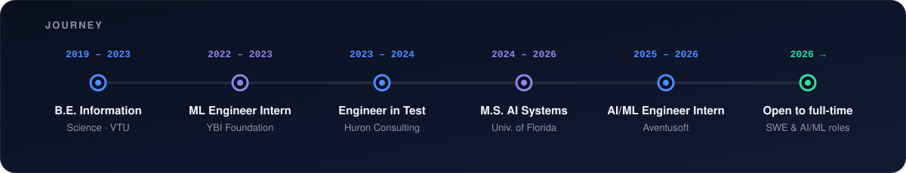

  

  

  
  
  
  
  

  <b>Prev ML Engineer @ Aventusoft // taught AI to catch missing heartbeats | MS AI @ UF | Prev SWE @ Huron // kept Salesforce from breaking | Next up: building products people can trust</b>  
  🔎 Open to full-time <b>ML Engineer · AI Engineer · Software Engineer</b> roles · open to relocation

## ⚡ About me

I build production-minded AI systems: retrieval and LLM applications, evaluation and observability tooling, and deep learning for medical signals and images.

- 🫀 **Most recently:** Machine Learning Engineer Intern at **Aventusoft** (Aug 2025 – May 2026), shipping ECG deep learning models for arrhythmia classification and PQRST fiducial detection (1D U-Net, CNN-LSTM and a transformer-based ECG foundation model), exported to TensorFlow Lite and deployed on AWS SageMaker
- 🛠️ **Now building:** LLM observability ([Spanscope](https://spanscope-llm-observability-dashboard.onrender.com/)), RAG over codebases ([CodeAtlas](https://codeatlas-rag.onrender.com)), and reward/preference-model evaluation
- 🌱 **Learning:** LLM inference and serving, Model Context Protocol (MCP), and event-driven systems at scale
- 💬 **Ask me about:** ECG signal processing, medical imaging, RAG and search ranking, LLM evaluation, PyTorch/TensorFlow optimization, deploying models to cloud and edge
- ⚡ **Fun fact:** I went from automating 120+ Salesforce test workflows as a QA engineer to building AI that detects heart conditions with 94% accuracy. Turns out debugging humans is harder than debugging code 🫀

## 🚀 Featured projects

<table>
  <tr>
    <td width="50%" valign="top">
      
      
<a href="https://spanscope-llm-observability-dashboard.onrender.com/"><b>▶ Live demo</b></a> · <a href="https://github.com/PrithviHL/Spanscope-LLM-observability-dashboard">Code</a>

    </td>
    <td width="50%" valign="top">
      
      
<a href="https://codeatlas-rag.onrender.com"><b>▶ Live demo</b></a> · <a href="https://github.com/PrithviHL/rag-over-codebase">Code</a>

    </td>
  </tr>
  <tr>
    <td width="50%" valign="top">
      
      
<a href="https://leavenow-prithvihl.onrender.com"><b>▶ Live demo</b></a> · <a href="https://github.com/PrithviHL/LeaveNow-Real-Time-Bus-Location-Tracking-and-Smart-Departure-Prediction">Code</a>

    </td>
    <td width="50%" valign="top">
      
      
<a href="https://prithvihl.github.io/voice/"><b>▶ Live demo</b></a> · <a href="https://drive.google.com/drive/folders/1DJyjVCoRY8r977VBq4hr7fjYT17MtLwN?usp=sharing">Video</a> · <a href="https://github.com/PrithviHL/Real-Time-Voice-Command-Recognition-on-ESP32">Code</a>

    </td>
  </tr>
</table>

Live demos run on free hosting and may take up to a minute to wake up.

<b>🧪 More projects and research</b>

 

| Project | What it does | Stack |
|---|---|---|
| **Cross-Repository Semantic Code Search** | Hybrid retrieval over multiple codebases: Neo4j code knowledge graph, BM25F + dense retrieval, cross-encoder reranking. **MRR@10: 0.61 → 0.83** | Python, Neo4j, Transformers, FastAPI |
| **BeatNet ECG Pipeline** | UF IPPD sponsored project with Aventusoft: fiducial detection and arrhythmia classification on single-lead 30 s ECG | PyTorch, 1D U-Net, ECG-FM, MIT-BIH |
| **Multi-Image MRI Super-Resolution** | Residual CNN with attention for MRI super-resolution (**PSNR 25.15 dB, SSIM 0.70**) with a Gradio demo | PyTorch, Gradio, HiPerGator |
| **Multimodal Medical VQA** | Three image–text fusion architectures on VQA-RAD; Adaptive Modality Weighting lifts accuracy **60.82% → 62.41%**; IEEE-format paper | PyTorch, Transformers |
| **Reward Signal Evaluation Framework** | Benchmarks preference/reward models and surfaces label-quality issues in training data | Python, PyTorch, Hugging Face |
| **[Point in 3D Mesh](https://github.com/PrithviHL/point-in-3D-mesh)** | Ray casting with Möller–Trumbore plus a winding-number fallback; a BVH makes queries **95× faster**, with 100% agreement on 40,000 test points | C++17 |
| **AI Resume-Tailoring Workflow** | Web-form automation that tailors ATS resumes and drafts outreach messages with Claude | n8n, Claude API |

## 🧭 Journey

<b>💼 Experience, 🎓 education and 📜 certifications</b>

 

**Experience**

- **AI/ML Engineer Intern**, Aventusoft Inc. · Aug 2025 – May 2026
- **Software Engineer in Test**, Huron Consulting Group · Jun 2023 – Jun 2024
- **Machine Learning Engineer Intern**, YBI Foundation, Delhi · May 2022 – Jun 2023

**Education**

- **M.S. Artificial Intelligence Systems**, University of Florida · 2024 – 2026
- **B.E. Information Science and Engineering**, Visvesvaraya Technological University, Bengaluru · 2019 – 2023

**Certifications**

AWS Certified Solutions Architect · Google Cloud Generative AI Leader · AWS Bedrock Agents · NVIDIA DLI: Generative AI with Diffusion Models

## 🛠️ Tech stack

  <b>Languages</b> 
  

  <b>ML and deep learning</b> 
  

  <b>Web and backend</b> 
  

  <b>Data and streaming</b> 
  

  <b>Cloud, MLOps and CI/CD</b> 
  

  <b>Edge and testing</b> 
  

  <b>LLMs, GenAI and more</b> 
  
  
  
  
  
  
  
  
  
  
  
  
  
  
  
  
  
  
  
  
  
  
  
  
  
  

## 📈 Contributions

<picture>
  <source media="(prefers-color-scheme: dark)" srcset="https://raw.githubusercontent.com/PrithviHL/PrithviHL/output/github-snake-dark.svg">
  <source media="(prefers-color-scheme: light)" srcset="https://raw.githubusercontent.com/PrithviHL/PrithviHL/output/github-snake.svg">
  
</picture>

  Thanks for stopping by. Explore the interactive <a href="https://prithvihl.github.io">portfolio</a>, say hi on <a href="https://www.linkedin.com/in/prithvihl/">LinkedIn</a>, or try one of the live demos above.

<!-- Artwork in assets/ is generated by scripts/build_assets.py; edit the text there and re-run it. -->
